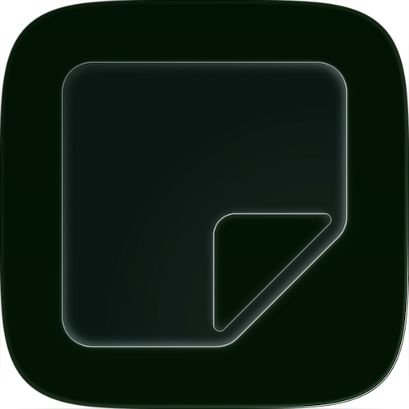

<p align="center">
  
</p>

<h1 align="center">Liquid Composer</h1>

<p align="center">Design Liquid Glass app icons in the browser.</p>

<p align="center"><a href="https://liquid-composer.vercel.app"><b>liquid-composer.vercel.app</b></a></p>

Liquid Composer is a web recreation of Apple's Icon Composer that reproduces the Liquid Glass icon material of iOS 27 and Icon Composer 2. Drop in your artwork, stack it in layers, and the engine renders the glass in real time: light from above, highlights and dark edges that define each shape, refraction between layers, background blur, translucency and layer shadows, composited inside the iOS squircle.

Rendering runs on a WebGL2 pipeline. A distance field of each layer's silhouette drives refraction and edge lighting; when Blur is on, two separable Gaussian passes blur everything beneath the layer, and the glass composite shader works in gamma-encoded sRGB, like Icon Composer. Without WebGL2 the app falls back to Canvas 2D: layers keep their shadow, translucency and edge lighting, but lose refraction and blur.

## What's new for iOS 27

- Light comes straight from above. The toolbar light-angle control remains as a preview tool and is not saved with the document
- Highlights along the top and bottom edges, and dark edges that define the shape
- Specular placement: Off, Automatic, Inside or Outside. Automatic picks Inside on bright icon backgrounds and Outside on dark ones and in the Clear appearances
- Refraction with Strength and Height; a negative Strength bends the image the other way (inverse refraction)

Highlights, refraction, translucency, blur and shadows follow the formulas and values of Icon Composer 27. The Advanced panel scales the highlights and adds dispersion and frostiness on top.

## Features

- Layer-based editing with one level of groups, drag-and-drop reordering, inline rename, duplicate and undo/redo
- SVG, PNG and JPEG import. SVGs are re-rasterized at render resolution so edges stay crisp
- Glass controls per layer, or applied to all layers at once: Specular placement, Refraction (Strength, Height), Blur, Translucency and Shadow
- Advanced panel with Lens (Dispersion), Highlights (Light intensity, Top, Bottom, Edge definition) and Surface (Frostiness), with a reset
- Per-layer opacity, blend mode, and solid or two-stop gradient fill
- Default, Dark, Clear Light and Clear Dark appearances. The Tinted variants of iOS 27 are not implemented
- Glass-on-glass compositing: each glass layer refracts the background and every layer painted beneath it
- Background editor driven by hue, tint and brightness, or custom gradient stops
- Apple icon grid overlay in light or dark lines, center snap guides, alpha-aware layer picking on canvas
- Export as PNG at 4096, 2048, 1024, 512 or 256 px, or JPEG at 1024; sizes up to 1024 are supersampled. PNG · No Chiclet leaves out the background plate. Copy a 1024 PNG to the clipboard, or download all appearances as a ZIP with `Default/`, `Dark/`, `ClearLight/` and `ClearDark/` folders, each holding PNGs from 4096 to 256 px
- Icon Composer documents: Export .icon and Open .icon in the export menu, as a zipped `.icon` package that opens in Icon Composer and Xcode. A document with refraction on or specular set to Inside or Outside needs Xcode 27, as Icon Composer 2 writes it; otherwise it also opens in Xcode 26
- Work is autosaved locally to localStorage and IndexedDB

## Shortcuts

`⌘` is `Ctrl` on Windows and Linux.

- `⌘Z` / `⇧⌘Z` undo and redo
- `⌘D` duplicate, `Delete` remove, `F2` rename the focused layer
- `⌘C` / `⌘X` / `⌘V` copy, cut and paste layers (or paste an image)
- Arrow keys move the selected layer by 1 pt, 10 pt with `⇧`
- `⌘]` / `⌘[` bring forward or send backward; `⌥⇧⌘F` / `⌥⇧⌘B` bring to front or send to back
- `⌥⌘C` / `⌥⌘V` copy and paste style: glass, fill, opacity and blend mode
- `⌥⌘G` toggle the icon grid

## Getting started (Build for Web)

Requires Node 20.19+ or 22.12+.

```sh
npm install
npm run dev      # http://localhost:5173
npm run build    # production build in dist/
```

## Desktop Builds (Debug)

```sh
npm install
npm run desktop # works on any os (debugging only)
```

## Windows Builds (Relese)

```sh
npm install        # if not dons so already
npm run dist:win   # NSIS installer + portable .exe
# Output in release/
```

## Macos Builds (Appinstaller)

```sh
npm install        # if not dons so already
npm run dist:mac   # .dmg
# Output in release/
```

# Linux Builds (Relese)

```sh
npm install        # if not dons so already
npm run dist:mac   # .dmg
npm run dist:linux # AppImage + .deb
# Output in release/
```

## Use with AI agents

Agents drive the same app and engine as the editor. An icon is a JSON recipe: background, layers top to bottom, glass settings and outputs. Applying a recipe replaces the document, and renders come from the WebGL2 engine in headless Chrome.

```sh
npm run build
npm run -s agent -- apply icon.json --out out/       # PNG, all-appearances zip or .icon, as the recipe asks
npm run -s agent -- render icon.json --size 512 --mode dark
npm run -s agent -- import App.icon --render 512
npm run -s agent -- validate icon.json
npm run -s agent -- schema
```

Each command prints one JSON object with the written files, the document state and any warnings. Rendering uses your installed Google Chrome through playwright-core, on SwiftShader by default; pass `--gpu` to use the GPU.

- **MCP server, local.** `node scripts/agent/cli.mjs mcp` provides `liquid_apply`, `liquid_update`, `liquid_render`, `liquid_export`, `liquid_import_icon`, `liquid_state` and `liquid_schema`, and returns previews as images. With Claude Code: `claude mcp add liquid-composer -- node /path/to/liquid-composer/scripts/agent/cli.mjs mcp`
- **MCP server, remote.** `https://liquid-composer.vercel.app/mcp` checks recipes and returns a link that opens the icon in your browser. The recipe travels in the URL fragment, so it never reaches the server. This server does not render
- **Skill.** `npx skills add frontedu/liquid-composer` teaches agents the recipe format and the workflow
- **In the browser.** Every build exposes `window.liquidComposer` (`apply`, `update`, `render`, `export`, `state`, `schema`). Add `?agent` to the URL to turn autosave off

## How it works

The editor is Vite, React 19, Tailwind and Nanostores. The engine lives in `src/engine/`:

- `IconRenderer.ts` orchestrates compositing. It rasterizes each layer, draws its shadow, resolves the specular placement and hands each glass layer everything already painted below it
- `LiquidGlass.ts` is the WebGL2 renderer: a jump-flood distance field of the layer's silhouette, ping-pong framebuffers for the blur (RGBA16F when supported, skipped when Blur is off), then the glass composite pass
- `shaders/` holds the GLSL ES 3.00 sources. The composite pass computes refraction, dispersion, translucency and the edge highlights and dark edges
- `glassContract.ts` holds the material constants: highlight table, refraction and blur limits, layer shadow
- `IconDocument.ts` reads and writes Icon Composer `.icon` documents

The agent API lives in `src/agent/`, the CLI and local MCP server in `scripts/agent/`, and the remote MCP endpoint in `api/mcp.ts`.
